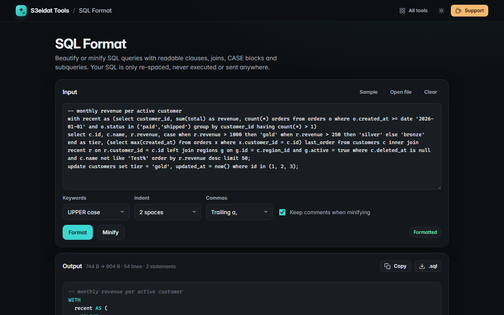

# SQL Format

> Format and minify SQL queries. Free, private, and it runs entirely in your browser. Your SQL is never executed.

### ▶ [Open SQL Format](https://s3eidat.github.io/sql-format/)



## Features

- **Beautify** `SELECT`, `INSERT`, `UPDATE`, `DELETE`, `CREATE TABLE`, `ALTER`, `WITH` (CTEs), `UNION`, joins, `CASE` blocks and subqueries
- Its own tokenizer understands strings (`'it''s'`, `E'\n'`, `$$dollar$$`), quoted identifiers (`"x"`, `` `x` ``, `[x]`), comments, numbers and placeholders (`?`, `$1`, `:name`, `@var`), so `--` inside a string is never mistaken for a comment
- **Keyword case**: UPPER, lower or keep as typed (identifiers are never touched)
- **Indent** with 2 spaces, 4 spaces or tabs; **trailing or leading commas**
- `AND`/`OR` on their own lines in `WHERE`, `HAVING` and join conditions, but not inside `BETWEEN … AND …`
- **Minify** to one line per statement, optionally keeping comments
- Syntax-highlighted output, copy or download as `.sql`, open or drop a `.sql` file, <kbd>Ctrl</kbd>+<kbd>Enter</kbd> to format
- Warns about an unclosed quote or comment

Formatting only changes whitespace and keyword case: a built-in self-test checks that the token sequence is identical before and after.
It is a formatter, not a validator, so it won't tell you whether a query is valid for your database.

## Privacy

Your SQL never leaves your device and nothing is executed. There is no server, no account, no analytics.
The page ships with a strict Content-Security-Policy (`connect-src 'self'`), so the browser
itself blocks any attempt to send data anywhere.

## Run it yourself

It's plain HTML, CSS and JavaScript with no build step:

```bash
git clone https://github.com/s3eidat/sql-format
cd sql-format
python -m http.server 8000
```

Then open http://localhost:8000.

## Support

If this saved you time, **[buy me a coffee ☕](https://s3eidat.github.io/coffee/)**. It keeps every tool free.

---

Part of **[S3eidat Tools](https://s3eidat.github.io/)**: 100+ free, private tools that run in your browser. MIT licensed.
